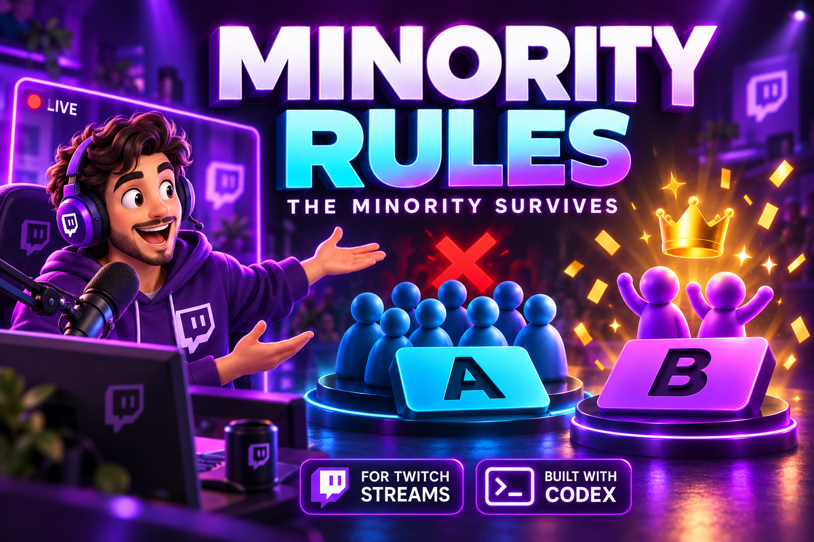

# Minority Rules

**Go against the crowd. The minority survives.**

A Twitch audience survival game built with OpenAI Codex. Viewers choose A or B in a custom Twitch Extension; the less popular answer survives. The streamer gets simple controls and a separate OBS display.



## Try it

| Experience | Link |
| --- | --- |
| Hosted dashboard and 100-player simulated demo | [minority-rules.nirvik.workers.dev](https://minority-rules.nirvik.workers.dev/) |
| Interactive voting-panel simulation | [Try the A/B panel](https://minority-rules.nirvik.workers.dev/extension/viewer.html?preview=1) |
| Twitch test channel | [twitch.tv/patelnirvik](https://www.twitch.tv/patelnirvik) |

Choose **Demo** and click **Start demo**. Fake players vote automatically. Click **Next round**, or enable **Auto-next round**, and continue to the winner celebration.

**Twitch status: Hosted Test, not public release.** Real test viewers must be on the Extension's Testing Account Allowlist. The simulated demo needs no Twitch account. Only the streamer installs the Extension; viewers use it on the channel and opt into Twitch identity sharing.

## Game rules

1. The host starts a question with A/B options and a countdown.
2. Viewers join by voting in round one. Each viewer gets one vote per round and can change it until the deadline.
3. The A/B split stays hidden during voting; only participation is visible.
4. After the reveal, the smaller voting side survives. The larger side is eliminated.
5. Rounds continue until 1-3 survivors win. Zero survivors produces “Nobody survived.”

Ties keep both voting sides alive. Surviving players who skip a round are eliminated. Unanimous votes eliminate everyone. Late arrivals spectate until the next game. With no first-round entrants, the game returns to waiting.

## Features

- Minimal 3D-style dashboard and responsive voting panel.
- 1920 x 1080 OBS display, dramatic reveals, named winners, optional sound, and animated confetti.
- **Welcome screen:** replace old results with an animated “The game will start soon” screen.
- **Auto-next round:** choose a 5-120 second pause after each reveal. Server timers keep rounds moving even if the dashboard closes. Automation stops at game over; new games require a manual start.
- **My questions:** add, edit, or delete up to 50 questions with two options each. All custom questions follow minority rules, with no fixed correct answer.
- Food, Games, Would You Rather, and Mixed packs; 60 built-in questions.
- Isolated 100-player demo rooms with simulated vote changes and missed votes.
- Persisted game state, server-owned deadlines, signed Twitch identities, and broadcaster-only controls.

## Run locally

Requires **Node.js 22.12 or newer** and npm.

```sh
git clone https://github.com/nirvikpatel/minority-rules-twitch.git
cd minority-rules-twitch
npm ci
npm run build
npm run preview
```

Open [http://localhost:8787](http://localhost:8787). Demo mode needs no secrets. Refreshing retains the current demo room in that browser.

For frontend development, keep Wrangler running and run `npm run dev` in a second terminal. Vite proxies API requests to port 8787.

The build packages the Extension into `minority-rules-extension.zip` in the parent directory. Its assets are also served at `/extension/`.

## Twitch and OBS setup

Read [EXTENSION_SETUP.md](EXTENSION_SETUP.md) for registration, hosting, identity sharing, tester allowlisting, and asset upload.

For the configured broadcaster:

1. Open Minority Rules in the Twitch Creator Dashboard's Extension configuration.
2. Click **Open game controls**, then **Continue to game controls**. The link expires after one minute and works once.
3. In the game dashboard, expand **Add to OBS** and copy the display URL.
4. In OBS, add a **Browser Source**, paste the URL, and set **1920 x 1080**.
5. Start the game from the dashboard. Viewers click A/B in the Extension and follow its countdown.

Live and simulated games use different display links. Enable sound on only one display to avoid duplicate audio.

## Deploy your own environment

The repository includes the Worker, static asset binding, SQLite Durable Object binding, and initial migration.

1. Register a Twitch Extension with Panel and Mobile views and Request Identity Link enabled.
2. Set your Worker name, public Extension client ID, numeric broadcaster ID, and app origin in `wrangler.jsonc`.
3. Replace the hosted origin in `extension/shared.ts` and `extension/config.ts` with your deployment URL. Update channel-specific labels and setup links for your channel.
4. Configure backend domain allowlists and viewer/configuration paths using the setup guide.
5. Set secrets using the interactive prompts and deploy:

```sh
npx wrangler login
npx wrangler secret put EXTENSION_SECRET
npx wrangler secret put SESSION_SECRET
npm run deploy
```

`EXTENSION_SECRET` is Twitch's base64-encoded Extension signing secret. `SESSION_SECRET` is a separate strong random value of at least 32 characters. Store both in Cloudflare's secret store. For local authenticated testing, copy `.dev.vars.example` to ignored `.dev.vars` and enter your own values. Never commit actual secrets.

## Architecture

| Area | Implementation |
| --- | --- |
| Dashboard and OBS display | React, TypeScript, Vite |
| Twitch frontend | TypeScript and Twitch Extension Helper |
| Hosting and API | Cloudflare Worker |
| Authoritative game state | SQLite-backed Durable Object |
| Game rules | Pure TypeScript engine |
| Tests | Vitest |

The Worker verifies Twitch signatures, expiry, channel, and role before trusting claims. Display names come from Twitch. Viewer responses include only that viewer's selection; shared state hides individual choices and A/B totals until reveal. The upcoming custom-question library is controller-only. OBS links cannot issue control commands.

## Validation

```sh
npm test
npm run build
npm run check:deploy
```

With Wrangler running:

```sh
node scripts/smoke.mjs
node scripts/full-game.mjs
```

**50 tests passed** in the latest functional verification. Coverage includes vote replacement, enrollment, ties, nonvoters, wipeouts, deadlines, stale commands, 1,000-player bursts, Twitch signatures and roles, private responses, welcome resets, automatic round recovery, and custom-question access.

A complete four-round simulated game advanced automatically and stopped at winners. Broadcaster controls and real viewer votes were tested on Twitch; a friend confirmed the authorization fix. Mobile-device and OBS-audio verification remain pending. [VERIFICATION.md](VERIFICATION.md) records the development checks.

## Security and public source

Production secrets, Twitch tokens, local databases, and authenticated control/display links are excluded. Public Twitch client/channel IDs and the hosted URL are identifiers, not credentials. Test keys are synthetic. See [SECURITY_REVIEW.md](SECURITY_REVIEW.md) for the release review and its limits.

This is a single-channel hackathon prototype. Before broad promotion, add rate limits to public demo creation and complete Twitch review. Publishing source does not make the Hosted Test Extension available to all viewers.

## Built with Codex

OpenAI Codex helped implement the engine, presentation, Twitch authentication, Cloudflare service, tests, deployment, and debugging. No runtime AI service is required. [SUBMISSION.md](SUBMISSION.md) contains the project description and video outline.
